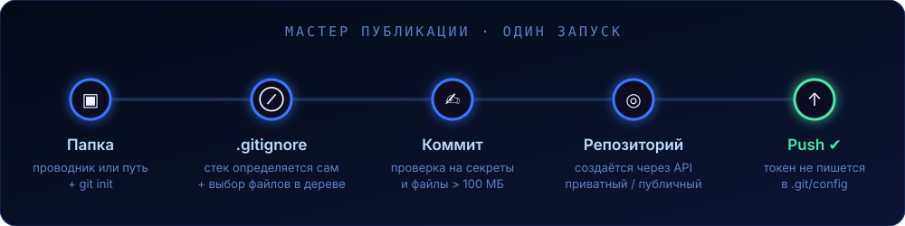

<div align="center">



<br>

[](https://www.rust-lang.org)
[](#-установка)
[](LICENSE)
[](#-установка)
[](CONTRIBUTING.md)

**Красивый консольный помощник для Git и GitHub.**<br>
Выбираешь папку, отмечаешь файлы, жмёшь Enter — проект на GitHub.<br>
Без запоминания команд, без утечек паролей, без боли.

[**⬇ Скачать**](../../releases/latest) · [Возможности](#-возможности) · [Как это выглядит](#-как-это-выглядит) · [Сборка](#-сборка-из-исходников) · [FAQ](#-faq)

</div>

<br>

## ✦ Зачем

Git — мощный, но неприветливый. Новичку, чтобы просто выложить проект, нужно помнить `init`, `add`, `commit`, `remote add`, `push -u`, разобраться с токенами и не забыть `.gitignore`, иначе на GitHub уедут `node_modules` и `.env` с паролями.

**GitHelper** превращает всё это в понятное меню со стрелками, а для опасных действий показывает предупреждения. Он не заменяет Git, а работает поверх настоящего `git.exe`, поэтому всё, что ты делаешь, остаётся обычным git-репозиторием.

<br>

## ◆ Как это выглядит

<div align="center">

<br><sub>Главное меню: строка статуса, быстрые клавиши <code>1-9</code> / <code>a-z</code>, плавная подсветка выбранного пункта</sub>
</div>

<br>

Всё выдержано в палитре **`color 9`**: светло-синий на чёрном, как в классическом `cmd`, плюс градиенты от тёмно-синего к голубому.

| Анимация | Где |
|---|---|
| Диагональное проявление логотипа с бликом | заставка при запуске |
| Полоса загрузки с суб-символьной точностью `▏▎▍▌▋▊▉█` | заставка, статистика, лимиты API |
| Каскадное появление пунктов меню | каждый экран |
| Вспышка выбранного пункта | меню |
| Градиентный спиннер `⠋⠙⠹⠸` с таймером | любые долгие операции |
| «Проявляющаяся» галочка ✔ | успешные действия |
| Печатная машинка | приветствие |

Скорость анимаций настраивается: **плавные** / **быстрые** / **выключены**.

<br>

## ✦ Возможности

<table>
<tr>
<td width="50%" valign="top">

### 🚀 Публикация в один мастер
Папка → `.gitignore` → коммит → новый репозиторий на GitHub → push → страница проекта открывается в браузере. Если репозиторий с таким именем уже есть, GitHelper предложит подключиться к нему.

</td>
<td width="50%" valign="top">

### ⊘ Умный `.gitignore`
Сам определяет стек: **Rust, Node, Python, C#, Java, Go, C++, Unity, Godot, PHP, Flutter**. Дальше можно отметить файлы в дереве, подключить любой из **200+ шаблонов GitHub**, дополнить существующий файл без дублей или обойтись без него.

</td>
</tr>
<tr>
<td valign="top">

### ⛨ Защита от утечек
Перед каждым коммитом ищет **токены GitHub, ключи AWS, приватные ключи, токены Telegram и Discord, ключи OpenAI и Anthropic, пароли в коде**, а также файлы `.env`, `*.pem` и `id_rsa`. Файлы больше 100 МБ, которые GitHub не примет, не пропускает в коммит.

</td>
<td valign="top">

### ✍ Коммиты без мучений
Файлы выбираешь галочками и фильтруешь поиском. Сообщение можно написать самому, сгенерировать автоматически или собрать в формате **Conventional Commits** (`feat`, `fix`, `docs`…) с областью и пометкой BREAKING CHANGE.

</td>
</tr>
<tr>
<td valign="top">

### ↶ Исправить ошибки
- отменить последний коммит, не трогая файлы
- исправить сообщение коммита или добавить забытый файл
- откатить изменения в выбранных файлах
- безопасный `revert` старого коммита
- **машина времени `reflog`**: вернуться к любому прошлому состоянию
- отменить незавершённый `merge` или `rebase`

</td>
<td valign="top">

### ⎇ Всё остальное
- **Ветки:** создать, переключить, слить, переименовать, удалить
- **История** в виде графа веток с прокруткой
- **Stash:** отложить изменения, вернуть, посмотреть, удалить
- **Синхронизация:** pull `--rebase` / merge и push, счётчики ↑↓
- **Релизы:** следующий номер версии (semver), тег и релиз с заметками из коммитов
- **README и LICENSE** по шаблонам (MIT, Apache, GPL…)
- **Статистика:** языки, авторы, активность за 12 недель
- **Клонирование** из списка твоих репозиториев
- **Быстрые ссылки:** Pull Request, Issues, Actions, Releases

</td>
</tr>
</table>

<br>

## 🚀 Публикация

<div align="center">

</div>

<br>

Токен передаётся в `git push` HTTP-заголовком на время одной команды. Он **не попадает** ни в `.git/config`, ни в URL remote, ни в историю команд.

<br>

## ⊘ `.gitignore` в дереве

<div align="center">

</div>

<br>

- **Пробел** отмечает файл или папку, **→ / ←** раскрывают и сворачивают папку, **R** оставляет только рекомендованные отметки
- `node_modules`, `target`, `bin/obj`, `.venv`, `.env`, логи и прочий мусор отмечены заранее (★)
- Если отметить папку, её содержимое тоже игнорируется (◌), дублей в итоговом файле нет
- Перед записью файл показывается с подсветкой
- Если какие-то файлы уже в репозитории, но теперь игнорируются, GitHelper предложит `git rm --cached`: из репозитория они уйдут, а на диске останутся

<br>

## ⛨ Проверка безопасности

<div align="center">

</div>

<br>

Проверка запускается автоматически при каждом коммите (её можно отключить в настройках) и отдельно из меню для всего проекта. Что она ищет:

| Тип | Примеры |
|---|---|
| Токены сервисов | `ghp_…`, `github_pat_…`, `AKIA…`, `AIza…`, `xoxb-…`, `sk_live_…`, `sk-ant-…`, `sk-proj-…` |
| Боты | токены Telegram и Discord |
| Ключи | `-----BEGIN … PRIVATE KEY-----`, `*.pem`, `*.pfx`, `*.p12`, `id_rsa`, `*.kdbx` |
| Конфиги | `.env`, `.env.*` (кроме `.env.example`), `credentials.json`, `secrets.json`, `.npmrc` |
| Пароли в коде | `password = "…"`, `api_key: '…'`, `secret = "…"` |
| Размер | > 50 МБ — предупреждение, > 100 МБ — файл не попадёт в коммит |

<br>

## ☺ Вход в GitHub

| Способ | Как работает |
|---|---|
| **✉ Почта и пароль** | Открывается официальное окно входа GitHub (через Git Credential Manager). Почта, пароль и **код 2FA** вводятся на стороне GitHub, пароль через GitHelper **не проходит** |
| **⚿ Токен (PAT)** | Вставляешь `ghp_…` или `github_pat_…`, ввод скрыт. Есть кнопка, которая открывает страницу создания токена с уже отмеченными правами |

> [!NOTE]
> С августа 2021 года GitHub не принимает пароль аккаунта напрямую в сторонних программах, поэтому вход по паролю идёт только через официальное окно. Так безопаснее: GitHelper никогда не видит твой пароль.

Токен хранится в **Диспетчере учётных данных Windows** (в зашифрованном виде), а не в текстовом файле. Если Git не знает твоё имя и почту, GitHelper предложит взять их из профиля GitHub, в том числе приватный адрес `…@users.noreply.github.com`.

<br>

## ⬇ Установка

1. Скачай **`GitHelper.exe`** со страницы [Releases](../../releases/latest)
2. Запусти

Больше ничего не нужно: один файл около 5 МБ, без .NET, Python и установщика.

Если **Git** не установлен, при первом запуске GitHelper предложит поставить его одной кнопкой через `winget` или откроет страницу загрузки.

```powershell
# можно сразу открыть нужный проект
GitHelper.exe C:\Projects\my-app
```

> [!TIP]
> Лучше всего GitHelper выглядит в **Windows Terminal** (стоит в Windows 11 по умолчанию) со шрифтом Cascadia Code. В классическом `cmd` он тоже работает.

<br>

## ⌨ Управление

| Клавиши | Действие |
|---|---|
| `↑` `↓` `PgUp` `PgDn` `Home` `End` | навигация |
| `Enter` / `→` | открыть пункт |
| `1`–`9`, `a`–`z` | быстрый выбор пункта меню |
| `Esc` / `←` | назад |
| `Пробел` | отметить в списке |
| `A` / `N` | отметить все / снять все |
| `/` | поиск по списку |
| `←` `→` | Да / Нет в подтверждениях |

<br>

## 🔧 Сборка из исходников

```powershell
git clone https://github.com/neflixoffical-cpu/GitHelper.git
cd GitHelper
cargo build --release
# готовый файл: target\release\githelper.exe
```

Нужен актуальный stable Rust (`rustup`) и MSVC Build Tools (C++).

<details>
<summary><b>Структура проекта</b></summary>

```
src/
├── main.rs        точка входа, заставка, первый запуск, главное меню
├── ui.rs          движок интерфейса: цвета color 9, анимации, меню, чек-листы, ввод, просмотр текста
├── git.rs         обёртка над git.exe, поиск git, вход через Credential Manager
├── github.rs      клиент GitHub REST API (репозитории, шаблоны, лицензии, релизы)
├── auth.rs        вход по почте/паролю и по токену, выход, имя и почта для коммитов
├── config.rs      настройки в %APPDATA%\GitHelper, хранение токена
├── gitignore.rs   определение стека, 16 встроенных шаблонов, интерактивное дерево
├── project.rs     выбор папки, статус, коммит, публикация, синхронизация, поиск секретов
└── tools.rs       ветки, история, stash, откат, релизы, README/LICENSE, статистика, клон
```

</details>

<details>
<summary><b>Зависимости</b></summary>

| Крейт | Зачем |
|---|---|
| `crossterm` | raw-режим терминала, клавиши, размер окна |
| `ureq` | HTTP-клиент для GitHub API (rustls, без OpenSSL) |
| `serde`, `serde_json` | JSON |
| `keyring` | Диспетчер учётных данных Windows |
| `rfd` | системное окно выбора папки |
| `regex` | поиск секретов |
| `base64`, `dirs`, `open` | мелочи |

</details>

<br>

## ❓ FAQ

<details>
<summary><b>Где хранятся мои данные?</b></summary>

- Настройки и недавние проекты: `%APPDATA%\GitHelper\config.json`
- Токен: Диспетчер учётных данных Windows → «Учётные данные Windows» → `GitHelper`
- Пароль от GitHub не хранится нигде, потому что GitHelper его никогда не получает

</details>

<details>
<summary><b>Чем это отличается от GitHub Desktop?</b></summary>

GitHelper работает в консоли, весит около 5 МБ и запускается мгновенно. В нём есть то, чего нет в Desktop: интерактивный `.gitignore` с определением стека, проверка на секреты перед коммитом, Conventional Commits, релизы с автоматическими заметками и «машина времени» через reflog.

</details>

<details>
<summary><b>Можно пользоваться без GitHub?</b></summary>

Да. Коммиты, ветки, история, stash, откат, `.gitignore`, проверка безопасности и статистика работают локально и без входа. Аккаунт GitHub нужен только для публикации, клонирования и релизов.

</details>

<details>
<summary><b>Push отклонён: «rejected / fetch first»</b></summary>

На GitHub есть коммиты, которых нет у тебя. Открой **Синхронизация → Синхронизировать**: GitHelper сделает `pull --rebase --autostash`, а затем push.

</details>

<details>
<summary><b>Работает на Linux или macOS?</b></summary>

Код почти кроссплатформенный (crossterm, ureq, keyring, rfd), но сейчас тестируется только на Windows. Будем рады PR!

</details>

<br>

## 🗺 Планы

- [x] Мастер публикации
- [x] Интерактивный `.gitignore` и шаблоны GitHub
- [x] Проверка на секреты и большие файлы
- [x] Релизы с автоматическими заметками
- [ ] Разрешение конфликтов слияния прямо в интерфейсе
- [ ] Git LFS для больших файлов
- [ ] Английский интерфейс
- [ ] Сборки для Linux и macOS
- [ ] Темы оформления помимо color 9

<br>

## 🤝 Участие

Issues и Pull Request'ы приветствуются, подробности в [CONTRIBUTING.md](CONTRIBUTING.md).

## 📄 Лицензия

[MIT](LICENSE): используй, меняй и распространяй как хочешь.

<br>

<div align="center">
<sub>Сделано с 💙 в цвете <code>color 9</code></sub>
</div>
